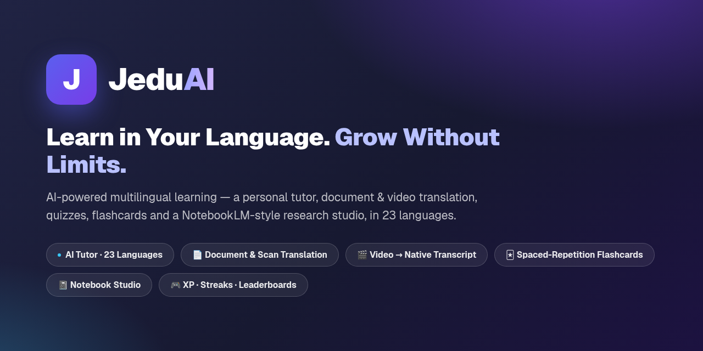
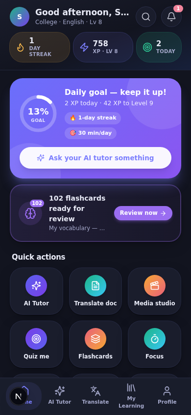
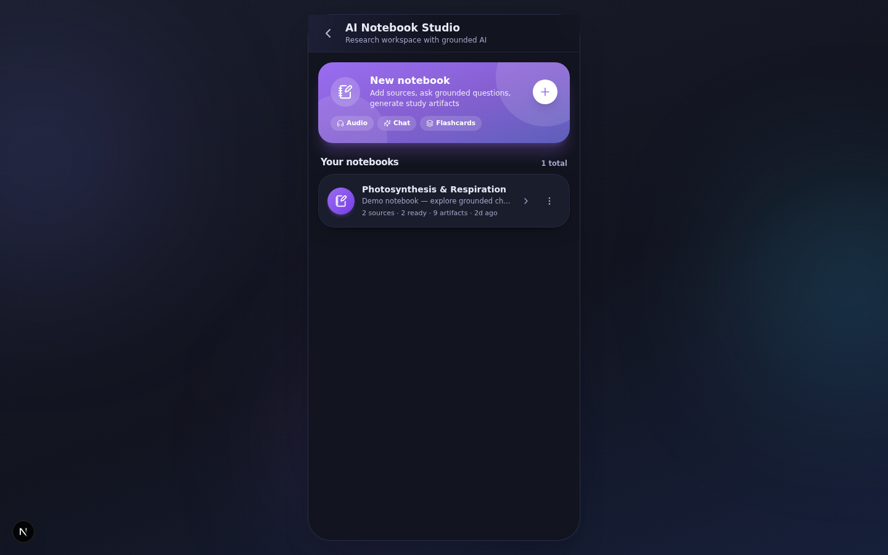
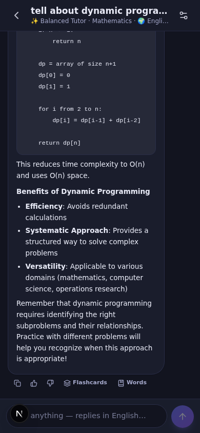
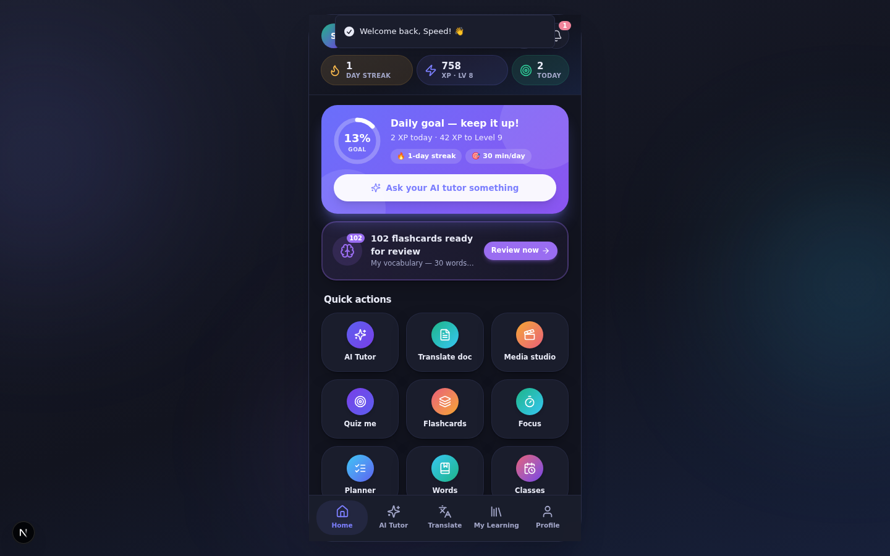

<div align="center">



# JeduAI — AI-Powered Multilingual Learning

**Learn in Your Language. Grow Without Limits.** 🌍

[](https://jeduai-app.space-z.ai/)
[](https://jeduai-app.space-z.ai/downloads/jeduai.apk)
[](#-iphone--ipad)


*A personal AI tutor, document & video translation, quizzes, flashcards, a study planner and a NotebookLM-style research studio — for Students, Staff and Admins, in **23 languages** (13 Indian + 10 international).*

</div>

---

## 📸 What it looks like

| Student dashboard (mobile-first) | Research-grade Notebook Studio (desktop) |
|:---:|:---:|
|  |  |
| **AI Tutor — real answers, 23 languages** | **Framed like a phone on desktop** |
|  |  |

---

## 📲 Get JeduAI on your device

### 🤖 Android — direct download (no setup!)

<p align="center">
  <a href="https://jeduai-app.space-z.ai/downloads/jeduai.apk">
    
  </a>
</p>

**Direct link:** <https://jeduai-app.space-z.ai/downloads/jeduai.apk>
*(mirror of the latest build in this repo: [`public/downloads/jeduai.apk`](public/downloads/jeduai.apk) → [raw download](https://github.com/Somesh4206/JeduAI-app/raw/main/public/downloads/jeduai.apk))*

1. **Tap the link** (or scan the QR) on your Android phone — the ~42 KB `.apk` downloads instantly.
2. **Open the file** and allow *"Install unknown apps"* if asked (it's a direct download, not from the Play Store).
3. **Open JeduAI** — the server is **pre-configured**, so it connects automatically. Just sign in (or create an account) and start learning. **No address to type, ever.**

> The app is locked to [`https://jeduai-app.space-z.ai`](https://jeduai-app.space-z.ai/) — your account and data stay on that server. It's a real, signed, zero-dependency native WebView client built from [`android/`](android/) in this repo (Android 7.0+, 42 KB).

### 🍎 iPhone & iPad

**Works today — no App Store needed:** open **[https://jeduai-app.space-z.ai](https://jeduai-app.space-z.ai/)** in **Safari** → tap **Share** → **Add to Home Screen**. You get a full-screen app with the JeduAI icon — same account, same data, works offline.

**Native Swift client:** a complete UIKit + WKWebView Xcode project (same locked-server architecture as the Android app, with the iOS share sheet, pull-to-refresh, document picker and offline screen) is ready in [`ios/`](ios/) — open it in Xcode and run it on your device with a **free Apple ID**, or distribute via TestFlight/App Store. See [`ios/README.md`](ios/README.md).

---

## ✨ Feature Highlights (all backed by real services)

| Area | What it does |
|---|---|
| **AI Tutor** | 6 tutor modes (Beginner / Exam / Step-by-step / Revision / Language / Balanced), 12 subjects, answers in any of 23 languages, conversation history, rename/delete, copy, retry, thumbs rating |
| **Translation Center** | Direct (faithful) & Learning (with vocabulary + grammar notes) modes, auto language detection, 23 languages (13 Indian + 10 international), history, saved translations, simple-language explanations |
| **Documents & E-books** | Upload PDF / DOCX / TXT / MD **or photos & scans (PNG/JPG/WEBP)** → **scanned PDFs and page photos are read with AI vision (OCR, up to 8 pages — pick WHICH pages for long scans, and re-pick the range when retrying a failed read)** → section-by-section AI translation with live progress; reader with translated/original/compare views, font-size control, search, bookmarks + notes, .txt/PDF export, ask-the-document |
| **Media Studio** | Upload audio/video → ffmpeg audio extraction → silence-aligned segmentation → **real AI speech-to-text per chunk** → timestamped translation; synced transcript player, summary, chapters, ask-about-video, quiz-from-video, .srt export (translated + original). Transcript/SRT/VTT paste also supported |
| **Quizzes** | AI-generated MCQ/true-false/short-answer quizzes in any language & difficulty, optional timer, keyword-graded short answers, per-question explanations, attempt history, **and a "Mistakes notebook" — every question you've missed (with your wrong answer vs the correct one and how many times you missed it) grouped per quiz, redeemed when you answer it right; one tap retries ONLY the missed questions, and "Practice all" runs one mixed session across every quiz's misses at once (subject pills, source chips per question)** |
| **Assessments** | Staff create manually or generate with AI (review-before-publish), students take them, auto-scored with explanations, submission stats |
| **Online Classes** | Staff schedule classes (Jitsi/meeting links), students browse/enroll/join, go-live & complete controls, notifications |
| **Study Planner** | 7-day plan, tasks with subjects & durations, daily goal progress, weak-subject detection, AI study tips |
| **Focus Timer** | Pomodoro-style study sessions (15/25/50 min presets, subject tags, pause/resume, 5-min breaks) — survives in-app navigation **and full page reloads**; completed sessions earn XP and log minutes into the study planner / daily goal |
| **Ask Your Content** | Ask-the-document (RAG-lite: keyword-relevant sections + AI answer with section citations, answered in the document's target language) and ask-the-video (timestamped transcript Q&A) |
| **Flashcards** | AI-generated decks from translated docs/media **or any tutor answer** ("Flashcards" action under AI replies) with Leitner spaced repetition (5 boxes), flip-card review, due reminders on Home, deck CSV export, **deck sharing — publish a 6-character code valid for 30 days (up to 25 imports), anyone can preview & import the deck into their own library; expired/retired codes are cleaned up automatically** — and **paste/CSV authoring: write your own deck as "front \| back" lines or load a .csv file (2–60 cards)**, plus **one-tap deck creation from your saved Vocabulary words** |
| **Vocabulary Builder** | Personal word collection: save key vocabulary from Learning-mode translations with one tap, extract words from tutor answers (then **practice them straight from the toast**), add your own — with Leitner-box multiple-choice practice (**distractors filtered for clarity**, +2 XP per correct answer), **🎓 brush-up mode that re-checks mastered words (a miss honestly un-masters them)**, **⚡ Speed Match game (75s timed pair-matching with combos & rounds)**, **weekly vocabulary report** (words added / sessions / correct charts), mastered tracking, search, due-word banners — and **turn any word set (all / due / learning / mastered) into a flashcard deck in one tap** |
| **Notifications** | Achievement/class/job alerts plus a daily digest synthesized server-side (due flashcards reminder, streak keeper) — Lucide-iconed notification center with unread badges |
| **Gamification** | XP, levels, 6 badges, streaks, weekly chart, leaderboard — points only for real completed activities |
| **Learning Insights** | Dedicated stats screen: This week / month / all-time ranges, XP-per-day chart, **goal-consistency card (hit-rate ring + per-day dots, best-run streak)**, **GitHub-style 13-week consistency heatmap (tap a square for that day's XP; tap a month to zoom in)**, activity breakdown, **"By subject" strength rows**, all-time library totals and best-day highlights |
| **Portals** | Staff portal (students, stats, quick actions, **class-scoped leaderboards with CSV export and "Message the class" broadcast**, **per-student drill-down: XP/streak/quiz-avg tiles, 7-day XP sparkline, open mistakes, recent attempts, activity feed**) and Admin portal (user management, role changes, analytics, pipeline/system monitor, **user-list CSV export**, same per-student drill-down) |
| **Notebook Studio** | NotebookLM-style research space: notebooks with multi-source ingestion (**PDF / DOCX / TXT / MD, photos & scans via AI-vision OCR, web pages, YouTube links, audio (ASR transcript), pasted text**), grounded chat with **inline source citations** (tap a citation to open the source), and **9 AI Studio artifacts** — Audio Overview (real two-host TTS podcast MP3), Video Overview (MP4 with chapters), Mind Map, Reports, Flashcards (→ Leitner library), Quizzes (→ scoring/history), Infographics (SVG + PNG export), Slides (PPTX export) and Data Tables (CSV export) — all generated server-side with live progress and honest failure states |

See [`docs/feature-mapping.md`](docs/feature-mapping.md) for the complete original-feature → new-feature mapping.

---

## 🚀 Quick Start (Windows / macOS / Linux)

**Requirements:** Node.js 20+ (or Bun 1.1+), a modern browser.

```bash
# 1. Install dependencies
bun install        # or: npm install

# 2. Configure environment (defaults work out of the box)
cp .env.example .env

# 3. Create the database
bun run db:push    # or: npx prisma db push

# 4. Start the dev server
bun run dev        # or: npm run dev
```

Open **http://localhost:3000** — the app frame renders like a phone; on a real phone it fills the screen.

### Demo accounts (seeded on first run)

| Role | Email | Password |
|---|---|---|
| Student | `student@jeduai.app` | `JeduAI@123` |
| Staff | `staff@jeduai.app` | `JeduAI@123` |
| Admin | `admin@jeduai.app` | `JeduAI@123` |

Sign-up is open to everyone. Creating **Staff**/**Admin** accounts at sign-up requires the join codes `JEDU-STAFF` / `JEDU-ADMIN` (demo accounts are protected from role changes/deletion so testing is always possible).

---

## ⚙️ Environment Variable

Copy `.env.example` → `.env`. Everything works with the defaults in this sandbox; for other deployments set:

| Variable | Purpose |
|---|---|
| `DATABASE_URL` | SQLite file path (Prisma) |
| `STAFF_JOIN_CODE` / `ADMIN_JOIN_CODE` | Codes required to self-register staff/admin (defaults: `JEDU-STAFF`, `JEDU-ADMIN`) |
| `ZAI_*` | z-ai-web-dev-sdk credentials (AI chat/ASR) — server-side only, never shipped to the client |

AI provider credentials live **only on the server** (`src/lib/jeduai/ai.ts`, `mediaworker.ts`). The client never sees an API key.

---

## 🏗 Architecture

```
src/
  app/
    page.tsx                  → single-page app shell (user-visible route)
    api/jeduai/*              → 40 REST endpoints (auth, tutor, translate,
                                 documents, media, notebook sources/chat/
                                 artifacts, quizzes, flashcards, vocab,
                                 library, planner, classes, assessments,
                                 notifications, admin…)
    globals.css               → JeduAI design tokens (light + dark)
  components/jeduai/
    app.tsx                   → boot, navigation stack, bottom tab bar
    store.tsx                 → zustand store + typed API client
    ui.tsx                    → design system (cards, chips, sheets, states)
    screens/                  → 27 screens (onboarding → portals + Notebook Studio)
  lib/jeduai/
    ai.ts                     → LLM service (tutor, translation, quizzes…)
    auth.ts                   → scrypt hashing, httpOnly session cookies
    gamify.ts                 → XP / streaks / badges engine
    files.ts                  → PDF/DOCX/TXT extraction, SRT/VTT parsing
    media.ts + mediaworker.ts → ffmpeg pipeline + ASR worker
    docworker.ts              → progressive document translation worker
    notebook/                 → Notebook Studio engine (ingest, BM25
                                 retrieval, grounding, web/YouTube import)
    studio/                   → artifact generators (TTS podcast, video,
                                 mindmap, slides, infographics, exports)
    seed.ts                   → demo data (idempotent)
android/                      → native Android client (Java, 42 KB, locked
                               to the JeduAI server, hand-built: no Gradle)
ios/                          → native iOS client (Swift + WKWebView,
                               Xcode project + CI build check)
prisma/schema.prisma          → 31 models (SQLite)
db/uploads/                   → user media uploads (ownership-checked)
```

**Security model:** every API route resolves the user from the httpOnly session cookie and scopes queries by `userId` — cross-user access is impossible regardless of what the client sends. Role checks (`Student`/`Staff`/`Admin`) are enforced server-side; rate limits protect AI endpoints; upload types/sizes are validated; AI answers for unpublished assessments are never sent before submission.

**Media pipeline (real, not mocked):** `ffmpeg` extracts mono 16 kHz audio, `silencedetect` splits it on natural speech pauses, each chunk is transcribed with the ASR service (`z-ai-web-dev-sdk`), timestamps come from the actual audio clock, then the LLM translates segment batches. Progress, failure, and retry states are persisted per segment.

---

## 📱 The native clients

Both clients are thin, signed shells around the web app — **the server URL is baked in at build time** (`https://jeduai-app.space-z.ai`), so the apps connect automatically on first launch and never ask the user for an address.

| | Android | iOS |
|---|---|---|
| Stack | Java WebView, zero dependencies | Swift UIKit + WKWebView |
| Size | 42 KB `.apk` | Xcode project |
| Install | Direct download ([link above](#-android--direct-download-no-setup)) | Xcode run (free Apple ID) / TestFlight / Add to Home Screen |
| Locked server | ✅ baked in | ✅ baked in |
| Offline screen | Branded, "Try again" only | Branded, "Try again" only |
| File uploads | Native picker, multi-select | Native document picker |
| Exports (CSV/MD…) | Saved to `Downloads/JeduAI` | iOS share sheet (Save to Files, AirDrop…) |
| Extras | Downloads via DownloadManager, hardware back | Pull-to-refresh, swipe-back |
| Build | `sh android/build.sh` (aapt2→ECJ→d8→sign) | Xcode, or the included GitHub Actions macOS build check |

**Rebuild / version-bump the APK:** edit `android/` (bump `versionCode`/`versionName` in `AndroidManifest.xml`) → `sh android/build.sh` (needs the Android build-tools toolchain — see the script's header comments) → copy `out/JeduAI.apk` to `public/downloads/jeduai.apk`. The signing keystore is kept at `android/jeduai.keystore` (self-signed, alias `jeduai`) so new versions upgrade-install over old ones; for Play Store distribution, re-sign with a Play upload key.

**PWA** — the web app itself installs from the browser: **Add to Home Screen** on Android Chrome/iOS Safari, or the install icon on desktop. The web manifest + service worker (`public/manifest.webmanifest`, `public/sw.js`) make it launch full-screen like a native app.

---

## 🧪 QA
End-to-end testing was completed in a real browser (agent-browser) during development. The following flows and features were verified:

User Journey
Onboarding → Signup → Preferences → Dashboard
Core Features
Live AI chat
Real-time translations (English → Hindi / Tamil)
Document upload → Progressive translation → Comparison reader

Video & Audio Pipeline
TTS-generated lecture → ASR → Timestamped Hindi transcript → Chapters / Summary / Quiz-from-video
Assessments & Learning
Quiz grading (including short answers)
Assessment submission
Class enrollment
Planner tasks

UI / UX
Dark mode
390 px mobile layout
Sticky bottom navigation
## ⚠️ Known Limitations

- OCR is AI-vision based with a practical cap (8 pages per pass — pick which pages for longer scans); illegible scans are reported honestly.
- ASR quality depends on audio clarity; very long media is capped (60 MB, ≤40 segments) with honest failure messages.
- Subtitle export is `.srt` (translated + original). No dubbed audio generation (Audio Overview podcasts are real TTS, not voice clones).
- Translated-text export is `.txt` (PDF re-rendering of translated scripts is not bundled).
- The original app's Firebase push notifications are represented as an in-app notification center (browser push not configured).
- Notebook chat retrieval is lexical (BM25-style) — strong on exact terms; the retriever interface is pluggable for embedding-based search later.
- YouTube imports depend on YouTube being reachable — some networks are bot-walled, and the app reports that honestly.
- The Android APK is self-signed: sideloading goes through Android's "install unknown apps" flow (guided in-app); it is verified statically (apksigner / zipalign / badging) but was not launched on a physical device during development. The iOS client cannot be compiled outside macOS — use the included CI workflow to verify it builds, and Xcode on a Mac to sign and run it.
